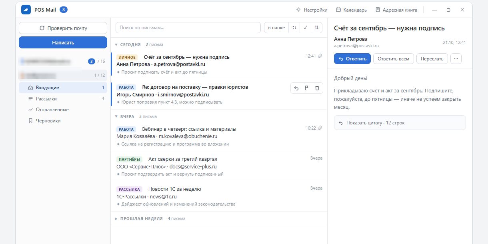
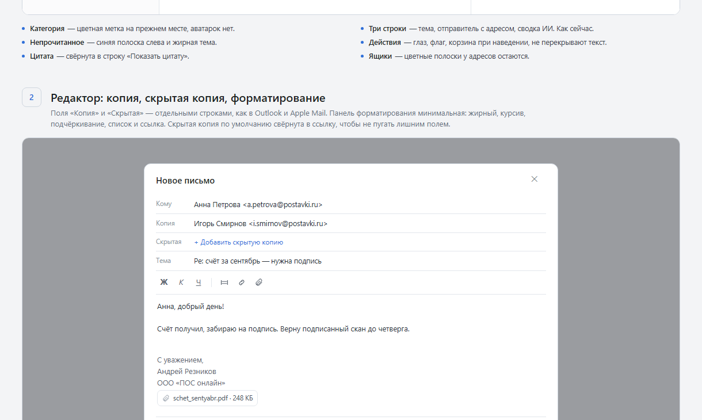
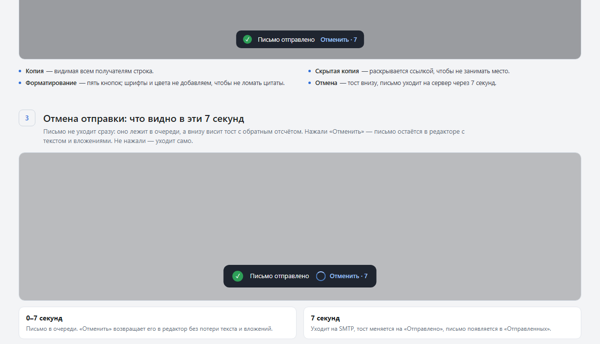

<div align="center">


# POS Mail

**Настольный почтовый клиент для Windows с ИИ-разбором корреспонденции.**
Несколько ящиков, быстрый локальный поиск, аккуратный список писем и помощник на GigaChat — в одном окне.


[Возможности](#возможности) · [Скриншоты](#скриншоты) · [Быстрый старт](#быстрый-старт) · [Сборка](#сборка-из-исходников) · [Архитектура](#архитектура)

</div>

---

## Что это

**POS Mail** (ранее — «Сорока») — локальный почтовый клиент для Windows: IMAP/SMTP, несколько аккаунтов, офлайн-кэш в SQLite и ИИ-помощник, который разбирает письма, но никогда не действует без подтверждения.

Клиент вырос из практической задачи: держать несколько рабочих и личных ящиков в одном окне, быстро находить нужное письмо и не тонуть в уведомлениях. Интерфейс — светлый, плотный, без «карточек» и лишнего декора; данные — на диске, а не в чужом облаке.

### Чем отличается

- **Всё локально.** Письма, вложения, контакты, настройки и кэш лежат в `%APPDATA%\Soroka`. Без вашего действия наружу уходит только запрос к GigaChat, если вы пользуетесь ИИ.
- **ИИ предлагает — человек решает.** Разбор, черновик ответа и перевод ничего не удаляют и не отправляют сами.
- **Быстрый старт.** Установщик 2.86 МБ, портативный exe 7.55 МБ, без Electron и фоновых сервисов.
- **Настоящие несколько ящиков.** Отдельные папки, подписи, интервалы проверки и цвета; можно раскрыть несколько ящиков одновременно.
- **Поиск вглубь.** По теме и отправителю, по тексту писем, в текущей папке, во всех папках ящика и во всех ящиках сразу.

---

## Возможности

### Почта

| | |
|---|---|
| **Ящики** | IMAP/SMTP, любое количество аккаунтов, индивидуальные подписи, интервалы автопроверки, очистка корзины при выходе |
| **Папки** | Дерево серверных папок, русские названия для системных папок, счётчики «непрочитано / всего», состояние раскрытия сохраняется |
| **Список** | Категории писем, группы «Сегодня / Вчера / …», плотный режим, цветные полосы ящиков, массовое выделение, Delete для всех выбранных |
| **Чтение** | HTML и текстовые письма, загрузка картинок по кнопке, вложения, сворачивание цитаты, отдельное окно письма с панелью действий |
| **Написание** | Копия и скрытая копия, минимальное форматирование, вложения, шаблоны и макросы подписи, автосохранение черновика, отмена отправки 7 секунд |
| **Порядок** | Поиск по всем ящикам, фильтры, сортировка и группировка, перенос писем в папки, отмена удаления и «В спам» на 7 секунд |
| **Система** | Трей, сворачивание в трей, автозапуск, тёмная и светлая темы, настраиваемая раскладка панелей |

### ИИ (GigaChat)

- **Разбор письма:** краткая суть, категория, важность, даты, задачи и предложенные действия.
- **Черновик ответа** в вашем стиле — с цитатой исходного письма.
- **Улучшение текста** и **перевод** письма на русский.
- Ключ хранится локально (`%APPDATA%\Soroka\gigachat.json` или переменная `SOROKA_GIGACHAT_KEY`), в интерфейс не возвращается.
- Любой результат ИИ — только предложение: отправить, удалить или переложить письмо можно лишь вручную.

---

## Скриншоты

| Список и панель ящиков | Редактор письма |
|---|---|
|  |  |

| Отмена отправки |
|---|
|  |

> На снимках — демонстрационные данные из макетов, не реальная переписка.

---

## Быстрый старт

1. Скачайте установщик `POS Mail_0.46.5_x64-setup.exe` из раздела **Releases** или соберите его сами (см. ниже).
2. Запустите установщик, выберите язык и установите программу для текущего пользователя.
3. При первом запуске добавьте ящик: адрес, пароль приложения IMAP/SMTP и серверы. Пароль хранится локально в `%APPDATA%\Soroka\accounts.json`.
4. По желанию откройте **Настройки → ИИ (GigaChat)** и вставьте ключ — без него почта работает полностью, ИИ-функции отключены.

**Портативный вариант:** `src-tauri\target\release\POSmail.exe` — запускается без установки.

Требования: Windows 10/11 x64, WebView2 (ставится установщиком при необходимости).

---

## Сборка из исходников

### Что нужно

- Rust stable (MSVC toolchain) и Cargo;
- Node.js 20+ и npm;
- Visual Studio Build Tools с компонентом «Desktop development with C++»;
- WebView2 Runtime.

### Команды

```powershell
git clone https://github.com/reznikov73/Soroka.git
cd Soroka
npm install
npm run tauri build
```

Готовые файлы:

```text
src-tauri\target\release\POSmail.exe
src-tauri\target\release\bundle\nsis\POS Mail_0.46.5_x64-setup.exe
```

Для разработки:

```powershell
npm run tauri dev
```

Если `cargo` не видит MSVC, запускайте сборку из «x64 Native Tools Command Prompt for VS» или предварительно настройте `PATH`, `LIB` и `INCLUDE` через `vcvars64.bat`.

---

## Архитектура

```text
src/                     фронтенд: TypeScript + Vite, без фреймворка
  main.ts                состояние, список, чтение, редактор, поиск, ИИ-карточки
  styles.css             светлая и тёмная темы, раскладка панелей
src-tauri/
  src/mail/
    imap.rs              IMAP: папки, заголовки, тела, вложения, переносы
    smtp.rs              SMTP и сборка MIME (text + HTML + вложения, Bcc)
    body.rs              разбор MIME, HTML → текст, кэш тел
    store.rs             SQLite: письма, папки, статистика, контакты, черновики
    accounts.rs          аккаунты и ключи папок «ящик::папка»
  src/ai/gigachat.rs     OAuth GigaChat, разбор, письма, перевод, ключи
  src/commands/mod.rs    команды Tauri и связка с фронтендом
  src/settings.rs        настройки пользователя
```

- **Оболочка:** Tauri 2, один процесс, нативное окно без Electron.
- **Хранилище:** SQLite `%APPDATA%\Soroka\soroka.db`; настройки — `settings.json`, аккаунты — `accounts.json`.
- **Сеть:** IMAP/SMTP напрямую; GigaChat — только при явном действии пользователя.
- **Кэш:** заголовки и тела писем сохраняются локально, поэтому список и чтение работают без сети.

---

## Данные и приватность

| Что | Где |
|---|---|
| Аккаунты и пароли | `%APPDATA%\Soroka\accounts.json` |
| Настройки, подписи, темы | `%APPDATA%\Soroka\settings.json` |
| Письма, контакты, черновики | `%APPDATA%\Soroka\soroka.db` |
| Ключ GigaChat | `%APPDATA%\Soroka\gigachat.json` или `SOROKA_GIGACHAT_KEY` |
| Логи | `%APPDATA%\Soroka\logs\` |

Секреты не попадают в репозиторий и не возвращаются в интерфейс. Пароли в `accounts.json` хранятся в открытом виде — это осознанный компромисс ради простоты; не передавайте файл третьим лицам.

---

## Производительность

| Артефакт | Размер |
|---|---|
| `POSmail.exe` | ~7.55 МБ |
| Установщик NSIS | ~2.86 МБ |
| Холодный запуск | несколько секунд, без фоновых служб |
| Память | зависит от числа открытых писем; HTML-тела выгружаются из DOM при переключении |

Клиент сознательно не тянет тяжёлые UI-фреймворки: интерфейс — ванильный TypeScript, оболочка — Tauri.

---

## Проверка

```powershell
npm run build          # tsc + vite
cd src-tauri
cargo test             # юнит-тесты бэкенда
cargo clippy -- -D warnings
cargo tauri build
```

---

## Дорожная карта

- [x] Несколько ящиков, IMAP/SMTP, офлайн-кэш
- [x] ИИ-разбор, черновик ответа, перевод, GigaChat-ключ в UI
- [x] Массовое выделение, поиск по всем ящикам, отдельное окно письма
- [ ] Печать письма с отдельным print-стилем
- [ ] Отложенная отправка и напоминания
- [ ] Полноценные цепочки писем (threads)
- [ ] Единая лента «Входящие» по всем ящикам

---

## Структура репозитория

```text
.
├─ src/                 фронтенд
├─ src-tauri/           Rust-бэкенд и конфигурация Tauri
├─ docs/screenshots/    снимки для README
├─ scripts/             вспомогательные PowerShell-скрипты
├─ tasks/               отчёты по задачам (вне git-дерева приложения)
└─ DELIVERY/            макеты интерфейса
```

---

<div align="center">

Сделано на Rust и Tauri. Почта — локально, решения — за вами.

</div>
